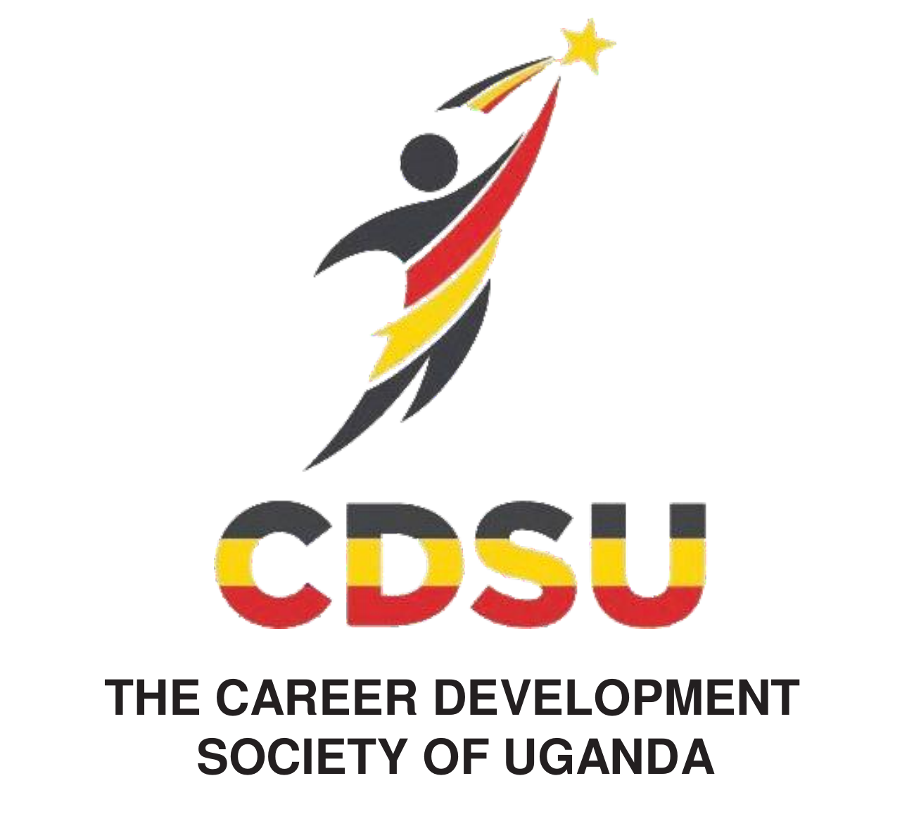
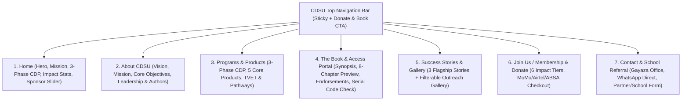
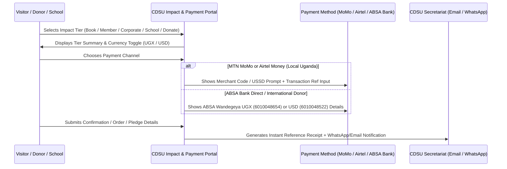

# CDSU Web Application & Website — Brand Kit & Implementation Plan



> [!IMPORTANT]
> **Core Executive Directive (from Audio Briefing & Copyright Notice):** The website must function as a clean, authoritative organization platform and interactive Career Development Programme (CDP) portal that **drives book sales, memberships, institutional partnerships, and global/local donations**—while **protecting the intellectual property of the book** (*Career Development: A Path to Wealth*, ISBN `978-9913-678-02-5`). The public site will feature the brochure's organizational narrative, a high-impact book & authors showcase, the 3 initial success stories, a clickable sponsor carousel, and interactive payment/membership flows without giving away the full textbook chapters for free.

---

## 1. Executive Synthesis: What CDSU Does & Audio Requirements

### 1.1 Organizational Identity (From Brochure, Synopsis & Manual)
* **Full Name:** The Career Development Society of Uganda (CDSU)
* **Motto / Tagline:** *"Building people first, for wealth to follow."*
* **Book Title:** *Career Development: A Path to Wealth* (Copyright © CDSU 2026, CDSU Publishers)
* **Nature of Organization:** A non-partisan, non-profit organization established to provide structured, data-driven career development that accelerates Uganda's national leap to high middle-income status (aligned with **NDPIV 2025/26–2029/30**, the **TVET Act 2025 / UVTAB**, MoES Competence-Based Curriculum reforms, and **Enterprise Uganda B.E.S.T** principles).
* **Vision:** To be the lead career development enterprise contributing to the production of balanced and wealthy citizens.
* **Mission:** To complement Government efforts in strengthening career pathways, aligning education and skills development with industry demands, and promoting innovation-driven wealth creation among the people of Uganda.
* **The 3-Phase Career Development Programme (CDP) Model:**
  1. **The Theorizing Phase:** Customized, thought-provoking career training seminars across schools, universities, parents, employees, and out-of-school youth using *Career Development: A Path to Wealth* as the lead reference.
  2. **The Practice Phase (Mentorship & Apprenticeship):** Supervised **Career Cluster (Clubs)** activities offering hands-on skill refinement, job shadowing, and mentorship.
  3. **The Exposure Phase:** Annual **Career Skills-Exhibition** themed events to showcase raw talent, recognize outstanding participants across career clusters, and enroll protégés into real-world apprenticeships and enterprise incubations.

````carousel

<!-- slide -->

````

### 1.2 Key Directives from the Executive Audio Briefing
| Timestamp | Executive Requirement | Web App Implementation Strategy |
| :--- | :--- | :--- |
| `00:00–00:08` & `01:58–02:29` | **Interactive Sponsor Carousel with Outbound Links:** Display a slide-through banner of sponsors where clicking a sponsor logo opens their official website. Start with confirmed/active partners (**Seeta University**, **UVTAB**, **Enterprise Uganda**) and allow easy toggling as pipeline sponsors (**Prudential**, **ABSA Bank**, **NSSF**) confirm. | Build a configurable, auto-playing + swipeable **Sponsors & Partners Marquee/Carousel** with outbound links (`target="_blank"`) and an dedicated **Sponsor Visibility / Advertise With Us** CTA reflecting the book's sponsor spaces. |
| `00:10–00:20` | **Success Stories Section:** Feature a dedicated section/column for impact stories, starting with the **3 flagship testimonies** from the book, and expandable as school/community outreaches roll out. | Create an inspiring **Success Stories Hub** with rich story cards and full-story modal/reader views for **Mr. Safari Daniel**, **Ms. Kirabo Mimi Rehema**, and **Mr. Kabenge Joy Lawrence ("Musawo")**. |
| `00:21–00:32` | **Ongoing Activity & School Outreach Gallery:** Include a photo/media gallery for school visits, career clubs, T.O.T sessions, and exhibitions as field implementation progresses. | Build a filterable **Outreach & Impact Gallery** (filterable by *School Seminars*, *Career Clubs*, *TVET & Exhibitions*, *B.E.S.T / Community Outreaches*) pre-populated with initial visual assets and ready for easy photo uploads. |
| `00:33–00:52` | **Global Donations & Bank Account Integration:** Enable donors anywhere in the world to contribute directly, displaying the official **ABSA Bank (Wandegeya Branch)** UGX (`6010048654`) and USD (`6010048522`) accounts clearly. | Build an interactive **Donate & Subscribe Portal** featuring one-click copyable ABSA UGX/USD bank details, international card/wire instructions, and downloadable payment receipts/pledge forms. |
| `00:53–01:03` | **MTN MoMo & Airtel Money Integration:** The Treasurer is finalizing official MTN MoMo and Airtel Money merchant codes; the site must support Mobile Money payments. | Include a dedicated **Mobile Money (MTN MoMo & Airtel Money)** payment tab in the checkout/donation modal with configurable merchant code variables so the exact codes drop in with zero code rework. |
| `01:05–01:29` | **Controlled Book IP ("Don't Give Away Too Much"):** Keep *About Us* aligned with the brochure; highlight the book, its synopsis, endorsements, and author profiles without exposing full textbook chapters for free. | Showcase the **Book Synopsis, 8-Chapter Preview Accordion, Keynote Endorsements** (Prof. Maggie Kigozi, Prof. Kefa Natolooka, Ms. Charity Barungi), and **Author Profiles**, paired with a **Book Order & Serial Number Access Code Portal**. |
| `02:31–02:42` | **Flexible Office Address & Contacts:** Use the Gayaza, Wakiso District address and phone/WhatsApp contacts from the brochure for now, designed for easy update when CDSU relocates offices. | Centralize all contact, address, bank, and MoMo/Airtel merchant details in a single `siteConfig` data module + Admin CMS settings panel. |
| `02:45–03:26` | **Communications Review by Madam Agnes (Ms. Ijuka Agnes Barongo):** The draft site will be reviewed by Ms. Ijuka Agnes Barongo (Senior Executive & Communications Expert) for look, themes, section placement, and wording. | Architect the UI with clean, modular section components and a centralized content dictionary so wording, ordering, and theme accents can be refined rapidly during Madam Agnes's review. |

---

## 2. Official CDSU Brand Kit (Extracted from Logo, Brochure & Book)

The CDSU logo features an upward-striding figure reaching for a golden star, wrapped in the **Ugandan national ribbons (Black, Sunshine Gold, Crimson Red)** above the bold tri-band `CDSU` wordmark, while the book cover and layout pair this energetic triad with **Institutional Royal Blue** for academic credibility and financial trust.

### 2.1 Color Palette
| Role | Color Name | Hex Code | RGB | Usage in the CDSU Web App |
| :--- | :--- | :--- | :--- | :--- |
| **Primary Brand Dark** | **Obsidian Charcoal** | `#1E1B20` | `rgb(30, 27, 32)` | Primary typography, navigation bar dark mode, footer background, top band of logo |
| **Primary Brand Red** | **Uganda Crimson** | `#D82828` | `rgb(216, 40, 40)` | Primary CTA buttons ("Join CDP", "Donate", "Buy the Book"), section pill badges (`OUR WORK`, `CONTACT US`), active states |
| **Primary Brand Gold** | **Star / Solar Gold** | `#F8D008` | `rgb(248, 208, 8)` | Highlight accents, star badges, ribbon dividers, hover glows, secondary dark-bg buttons |
| **Institutional Accent** | **Royal Academic Blue** | `#18509C` | `rgb(24, 80, 156)` | Trust sections (Institutional Partnerships, TVET & University Pathways, Bank/Sponsor cards, Table headers) |
| **Deep Navy** | **Midnight Indigo** | `#122854` | `rgb(18, 40, 84)` | Hero gradient overlays, executive quote cards, stats banner background |
| **Soft Surface Tint** | **Periwinkle Mist** | `#F0EFF9` | `rgb(240, 239, 249)` | Subtle section backgrounds (inspired by the book's chapter divider cards), assessment cards |
| **Warm Neutral Surface** | **Ivory / Alabaster** | `#FAF9F6` | `rgb(250, 249, 246)` | Main page background for effortless readability and warmth |

> [!TIP]
> **Signature Visual Motif:** Both the brochure and book cover use a **tri-color ribbon wave / geometric chevron** (Black `#1E1B20`, Gold `#F8D008`, Red `#D82828`) paired with clean white cards and Royal Blue (`#18509C`) structural anchors. We will incorporate this custom SVG ribbon divider and geometric corner framing into the Hero, Section Headers, and Footer for 100% brand continuity.

### 2.2 Typography System
* **Display & Headings Font:** **`Plus Jakarta Sans`** or **`Montserrat`** (Bold / ExtraBold `700–800`) — mirrors the strong, geometric uppercase sans-serif used on *"CAREER DEVELOPMENT"*, *"CDSU"*, and brochure pill headers.
* **Body & Editorial Font:** **`Inter`** or **`DM Sans`** (`400`, `500`, `600`) — clean, highly legible modern sans-serif for programme descriptions, tables, and interactive tools.
* **Editorial Quotes & Keynote Font:** **`Merriweather`** or **`Playfair Display`** (Italic/Regular) — honors the book's serif literary heritage for Prof. Maggie Kigozi's Keynote, scriptural/proverb callouts, and *"Building people first, for wealth to follow."*

---

## 3. Information Architecture & Sitemap



---

## 4. Detailed Page & Feature Breakdown

### 4.1 Home & Hero Experience
* **Hero Banner:**
  * Headline: *"Career Development: A Path to Wealth"*
  * Motto Badge: *"Building People First, For Wealth to Follow"*
  * Value Proposition: Empowering Ugandan youth (ages 8–35), students, parents, and institutions through structured career guidance, TVET & entrepreneurship pathways, and practical wealth creation.
  * Dual CTAs: **`Explore the Programme / Get the Book (UGX 50,000)`** (Crimson `#D82828`) + **`Support / Donate`** (Gold `#F8D008` / Outlined).
  * Visual Showcase: Interactive 3D presentation of the *Career Development: A Path to Wealth* manual alongside the 4 career cluster circular badges (Healthcare, Uniformed/Technical Services, Creative Media, Sports/Entrepreneurship).
* **Interactive Sponsor & Partner Carousel (Audio Requirement `00:00–00:08`, `01:58–02:25`):**
  * Auto-scrolling and clickable logo strip featuring:
    1. **Seeta University** (Active Sponsor — links to official website)
    2. **UVTAB — Uganda Vocational & Technical Assessment Board** (Active Partner/Sponsor — links to `uvtab.go.ug`)
    3. **Enterprise Uganda** (Development & B.E.S.T Training Partner — links to `enterprise.co.ug`)
    4. **St. Mary's College Kisubi (SMACK) — Careers Office** (Contributing Partner)
    5. **Avance International University** & **Victoria University** (Academic Contributors)
    6. *Configurable Pipeline Slots* (ready to toggle on via config: **ABSA Bank**, **Prudential Uganda**, **NSSF**) + a **"Become a Sponsor / Book Ad Space"** card that opens the Corporate Sponsor modal.

### 4.2 About Us & Leadership / Authors Showcase (Audio Requirement `01:05–01:20`)
* **Who We Are (Brochure Copy):** Non-partisan, non-profit organization raising a critical mass of citizens with productive skills aligned with Uganda's National Development Plan IV (NDPIV), NHRDP, and TVET Act 2025.
* **Vision, Mission & 4 Core Objectives:**
  1. **Increase Career Awareness:** Research publications, books, journals, e-magazines, and continuous sensitization outreaches for youth (8–35), parents, and educators.
  2. **Education–Industry Linkages:** Job-shadowing, mentorship, and apprenticeship networks aligning training with labour-market demand.
  3. **Sustainable Income-Generating Ventures:** Viable business models with AfCFTA in view.
  4. **Social Inclusion & Collective Economics:** Decent work promotion for women, PWDs, refugees, and out-of-school/long-term unemployed youth.
* **The Authors & Executive Team Profiles (From Page 183 / Page 2 of Book):**
  * **Mr. Ivan Dan Gitta** — *Concept Developer & Executive Director, CDSU* (MA Organizational Leadership & Management - UCU; PGD Health Systems Care - Manchester University UK; BA Education - Kyambogo University; former Dean of Students, Star International University, Juba).
  * **Dr. Kato Kimata Joshua (PhD)** — *Co-Author & Substantive Vice Chancellor, Avance International University* (PhD & Masters in Education Planning & Management, Kyambogo University).
  * **Dr. Simon Mwesigwa (PhD)** — *Co-Author & Deputy Vice Chancellor – Administration, Destiny University* (PhD Theology - Florida USA; MBA & B.Ed - Makerere University; 25+ years in Education Administration).
  * **Ms. Stella Naisanga** — *Co-Author & Youth/Women Empowerment Specialist* (B.IBA - KIU; Dip. ICT & Education - Makerere University; Guidance & Counseling - Reachout Uganda).
  * **Ms. Charity Barungi B.** — *Co-Author & Careers Counselor, St. Mary's College Kisubi (SMACK)* (MBA HR - Uganda Martyrs University; B.Ed English & Literature - Makerere University).
  * **Editorial & Executive Review Board:** Highlighting **Ms. Ijuka Agnes Barongo** (Senior Executive, CDSU & Communications Lead), **Prof. Kefa Natolooka**, **Dr. Ronald Mbago** (Seeta University), **Mr. Businge Conan Daniel** (Victoria University), **Mr. Kambaho Narasi Anyijuka** (UVTAB), and **Mr. Boniface Ssebukalu**.

### 4.3 Our Work & 5 Core Products (From Brochure)
* **The 3-Phase CDP Journey Interactive Stepper:**
  1. **Phase A: Theorizing Phase** (Book-guided seminars & mindset shift)
  2. **Phase B: Practice Phase** (Supervised Career Cluster Clubs, Mentorship & Apprenticeships)
  3. **Phase C: Exposure Phase** (Annual Career Skills-Exhibition, Talent Recruitment & Enterprise Launch)
* **The 5 Core Products & Services Grid:**
  1. *"Career Development: A Path to Wealth"* Reference Manual (ISBN `978-9913-678-02-5`)
  2. *Training of Trainers (T.O.T)* & School Counseling Department Setup
  3. *Career-Club Based Facilitation* of Youth Innovation & Enterprise Development
  4. *Skills & Talent Enhancing Platforms* (Annual Exhibitions, Competitions & Networks)
  5. *Career-Based Job-Shadowing, Mentorship & Apprenticeship Linkages*

### 4.4 The Book Showcase & Interactive Companion Tools (Protecting IP while Adding Web-App Value)
* **Book Overview & Endorsements:**
  * Keynote message highlight by **Prof. Maggie Kigozi** (*Former Executive Director, Uganda Investment Authority*).
  * Counselor's foreword by **Ms. Charity Barungi B.** (*SMACK*) & Academic Endorsement by **Prof. Kefa Natolooka**.
* **8-Chapter Interactive Syllabus Preview (Teaser Only — Protects Book Sales):**
  * Displays the title and 3-bullet learning outcome of each chapter (Ch 1: *Foundations, Career & Wealth Creation*; Ch 2: *Environmental Factors: Parents, Mentors & Institutions*; Ch 3: *Self-Awareness, Passion vs. Competence & Social EQ*; Ch 4: *Everyone is Unique — A Case for TVET & UVTAB Pathways*; Ch 5: *Career Clusters, Entrepreneurship (B.E.S.T), AI & CV/Interview Mastery*; Ch 6: *Overcoming Challenges & Financial Literacy / The 10-30-50-10 Rule*; Ch 7: *Value of Work, Change Management & The Career–Retirement Continuum*; Ch 8: *Walking in Wisdom & Action Annexures*).
* **Web-App Interactive Feature 1: Book Serial Number / CDP Access Code Verification Portal:**
  * Directly implements the requirement on Page 2 of the book: *"The beneficiaries will also need the serial number on an original book copy to generate the access code for participating in the Career Development Program activities and our complementary Services."*
  * Users who purchased an original copy can enter their **Name, School/Community, Phone/Email, and Book Serial Number** to validate/register for a CDP Access Code, while those without a book are prompted to order one for `UGX 50,000`.
* **Web-App Interactive Feature 2: Self-Awareness & Career Cluster Discovery Mini-Tool (From Annexure 3 & 2):**
  * A 2-minute interactive teaser of **Annexure 3 (Self-Awareness & Career Direction Tool)** and **Annexure 2 (Money Personality Quiz)**.
  * Learners select their top interests, strengths, and work styles across the 6 CDSU Career Clusters (*STEM*, *Business & Entrepreneurship*, *Social Services/Education/Health*, *Technical/TVET*, *Creative Arts/Media*, *Security/Sports*) to get an instant **Top 2 Career Cluster Recommendation** and a prompt to unlock the full workbook & mentorship program.

### 4.5 Success Stories & Outreach Gallery (Audio Requirement `00:10–00:32`)
* **Featured Success Stories (Pre-loaded from the Book):**
  1. **Mr. Safari Daniel — Clinical Epidemiologist:** *"From the Ghetto of Namuwongo to Global Science"* — How a two-hour career guidance session with Mr. Ivan Dan Gitta unlocked his true purpose in Microbiology and Epidemiology (Clarke International University $\rightarrow$ Carolina University USA, NIH Grant Recipient, Harvard Medical School Certificate).
  2. **Ms. Kirabo Mimi Rehema — Student Entrepreneur (Seeta High School):** *"Turning New Competence-Based Curriculum Knowledge into a Business Win"* — How a Senior One biology lesson on *Lactobacillus* inspired **Mimi's Yogurt**, now supplying supermarkets in Jinja and Seeta.
  3. **Mr. Kabenge Joy Lawrence ("Musawo") — TVET & Agribusiness Innovator:** *"Taking a Different Path: Why Choosing an Agricultural Course Can Be a Game Changer"* — Overcoming TVET stigma after S.4 to earn a National Certificate in Agricultural Production at Ssese Farm Institute, advancing to a Diploma at Bukalasa Agricultural College while running a thriving poultry & veterinary venture.
* **"Submit Your Story" CTA:** Allows students, teachers, and club leads to submit their CDP testimonies and role-play recordings (as invited on pages 35 & 172 of the book).
* **Outreach & Implementation Gallery:**
  * Filterable photo & event gallery (*All*, *School Seminars*, *Career Clubs*, *TVET & Exhibitions*, *Enterprise & B.E.S.T Training*) with lightbox preview and an "Add New Outreach Album" capability for ongoing school visits.

### 4.6 "Join Us for Impact" — Membership, Subscriptions & Global/MoMo Donations Portal (Audio Requirement `00:38–01:03`)



* **All 6 Official Impact & Subscription Tiers (From Brochure Page 2):**
  1. **Buy the Book (`UGX 50,000`):** Order from authorized distribution points or request delivery.
  2. **Ordinary Member — Adult (`UGX 50,000`):** Includes subscription + access to 1 copy of the book.
  3. **Ordinary Member — Student (`UGX 20,000`):** Student CDP membership (without book).
  4. **Subscribe for Training (`UGX 50,000`):** Youth, Parents, or Training of Trainers (T.O.T).
  5. **Corporate Member / Sponsor (`UGX 1,000,000`):** Access to reports, top protégés for recruitment/apprenticeships, investment options, and brand visibility in the book & outreach platforms.
  6. **Beneficiary School / College / Community Group Package:** Procure a minimum of **100 books** OR mobilize at least **250 ordinary members** (unlocks **20 complimentary books** to guide school training sessions + Career Club setup).
* **Unified Donation & Payment Checkout Modal:**
  * **Direct Bank Transfer (Global & Local):**
    * **Bank:** ABSA Bank, Wandegeya Branch, Uganda
    * **Account Name:** The Career Development Society of Uganda
    * **UGX Account No.:** `6010048654` (One-click copy)
    * **USD Account No.:** `6010048522` (One-click copy)
  * **Mobile Money (MTN MoMo & Airtel Money):**
    * Dedicated tab with step-by-step USSD instructions and configurable Merchant Code badges (`MTN MoMo Merchant Code` & `Airtel Money Merchant Code`—ready for the Treasurer's codes) plus instant WhatsApp/Email payment confirmation submission.
  * **Donor & Grant Proposals Tab:** Inviting private/group donations and calls for proposals targeting youth, TVET, and education development.

---

## 5. Technical Architecture & Implementation Stack

> [!NOTE]
> Because the Executive noted that **Ms. Ijuka Agnes Barongo** (Communications Expert) will review the draft layout, wording, and themes—and that **office addresses, MoMo/Airtel merchant codes, partner schools, and gallery photos** will be updated as implementation grows—we will structure the codebase around a **centralized, single-file-editable Content & Brand Configuration (`src/data/cdsuData.js`)** plus an in-app **Admin / Content Preview Customizer**.

* **Frontend Stack:** Modern **React 19 + Vite + Tailwind CSS + Lucide Icons** (fast, zero-latency SPA with responsive mobile-first design optimized for Ugandan mobile and desktop users).
* **Proposed Directory Structure (`/home/treez/Desktop/TREEZ AFRICA SYSTEMS/CDSU`):**
  * `public/assets/` — Extracted high-res `cdsu-logo.png`, book cover renders, author portraits, and initial success story photos (Safari Daniel, Kirabo Mimi Rehema, Kabenge Joy Lawrence, Prof. Maggie Kigozi, Ms. Charity Barungi).
  * `src/data/cdsuConfig.js` — Centralized configuration for:
    * Contact details (Plot 5007, Valley Drive, Bulamu Ward, Gayaza, Wakiso District; phones `+256 746 265 724`, `+256 759 746 364`, `+256 791 662 188`, WhatsApp `+211 988 196 141`, email `info.cdsu@gmail.com`)
    * Bank & Mobile Money details (ABSA UGX `6010048654`, USD `6010048522`, MTN MoMo & Airtel Money merchant code slots)
    * Sponsors list & outbound URLs (Seeta University, UVTAB, Enterprise Uganda, plus toggleable pipeline sponsors)
    * All section copy, success stories, and gallery items (for rapid edits after Madam Agnes's review).
  * `src/components/`
    * `Navbar.jsx` — Sticky responsive header with CDSU logo, navigation links, and quick `Donate` / `Get the Book` buttons.
    * `HeroSection.jsx` — High-impact hero with book showcase, Ugandan ribbon motif, key impact metrics, and CTAs.
    * `SponsorCarousel.jsx` — Interactive clickable sponsor slider with outbound links + "Become a Sponsor" modal trigger.
    * `AboutAndAuthors.jsx` — Vision, Mission, Core Objectives, Keynote endorsement, and Author/Leadership cards.
    * `ProgrammeAndProducts.jsx` — The 3-Phase CDP interactive tabs, 5 Core Products, and Uganda Education/TVET Pathways diagram.
    * `BookAndToolsSection.jsx` — Book synopsis, 8-chapter accordion teaser, **Book Serial Number / Access Code Portal**, and **Interactive Career Cluster Self-Assessment Quiz**.
    * `SuccessStoriesAndGallery.jsx` — Full reader cards for the 3 flagship stories + filterable Outreach Photo Gallery.
    * `ImpactAndDonateModal.jsx` — The 6 subscription/membership tiers + global ABSA Bank & MTN/Airtel Mobile Money checkout flow.
    * `ContactAndReferral.jsx` — School/Institution referral form, partner inquiry form, and direct WhatsApp/Email integration.
    * `Footer.jsx` — Tri-color Ugandan wave footer, quick links, ISBN & copyright notice.

---

## 6. Verification & Review Plan

1. **Visual & Brand Fidelity Check:** Verify that the extracted CDSU logo, book cover, author portraits, and exact brand palette (`#1E1B20`, `#D82828`, `#F8D008`, `#18509C`) render crisply across desktop and mobile viewports.
2. **Audio Requirement Checklist Verification:**
   * Clickable Sponsor Carousel linking to external sponsor websites.
   * Success Stories section populated with the 3 book testimonies and expandable for future school outreach stories.
   * Filterable Photo Gallery ready for ongoing school/community implementation photos.
   * Global Donation & Membership checkout displaying ABSA UGX/USD accounts and MTN MoMo / Airtel Money merchant code slots.
   * Book IP protection verified (brochure-level About Us, synopsis, and interactive companion quiz/serial verification without leaking full book chapters).
3. **Madam Agnes Review Readiness:** Ensure all headings, descriptions, contact details, and payment codes can be updated in seconds from a single configuration file (`src/data/cdsuConfig.js`).
